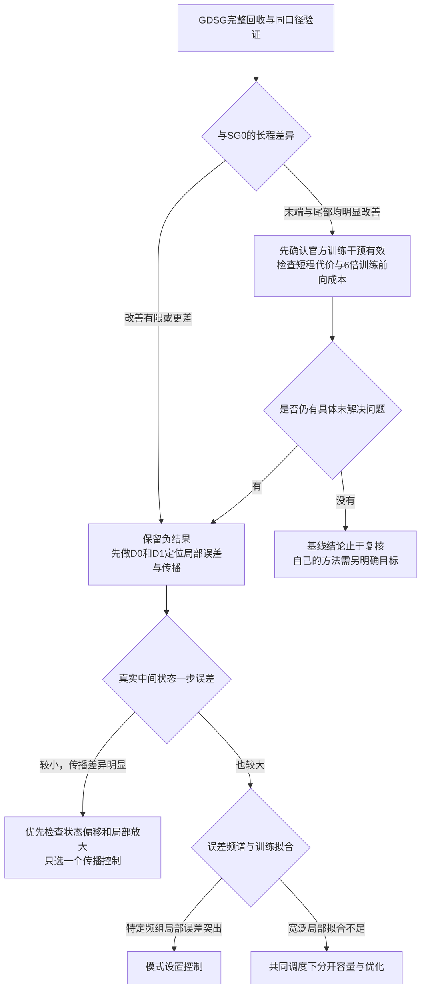

# 官方基线之后：最小诊断与有条件研究路线

日期：2026-10-04。状态：方案准备，已纳入主线程完成的SG0真实状态重启评估；本文件编写没有执行训练或修改模型。**等GDSG完整回收并按同一口径验证后再选择路线**。

## 1. 先回答哪个问题

当前需要解释的是：普通拟合的一步平均相对L2约0.001303，为什么99步后平均误差达到2.8410，并有少数轨迹明显增长？候选原因分为容量、优化进度、递归预测所经过的状态、空间频率四类。它们可能同时存在，不能凭一张误差曲线强行选一个原因。

本轮顺序固定为：

1. 用已有结果比较官方SG0与GDSG。
2. 对已有数组做幅度、偏置和频谱后处理。
3. 如仍有需要，仅对冻结模型评估少量中间状态。
4. 有明确疑点后才选择一个训练对照；不同时扫宽度、深度、模式数、正则、噪声和训练时长。

依据：[SG0科学审阅](../../outputs/due-official-vorticity-20261004/sg0-analysis/SCIENTIFIC_REVIEW.zh.md)、[可重跑诊断及输入哈希](../../outputs/due-official-vorticity-20261004/sg0-analysis/diagnostic_metrics.json)、[官方理论与实现核对](THEORY_AUDIT.zh.md)。

## 2. 现有证据已经回答和没有回答的事

| 问题 | 已有证据 | 当前能作出的判断 |
| --- | --- | --- |
| 是否仍是33/1313参数的小模型 | 官方FNO有467,661个张量元素，折算928,461个实标量坐标 | 当前结果来自较大的官方FNO；参数数量本身仍不能证明表达能力足够 |
| 是否只训练了很短时间 | 500轮、62,500更新已核实 | 排除“漏跑官方预算”；不能排除优化不足 |
| 末端变平是否证明收敛 | 最后50/10轮训练目标下降4.50%/0.245%，学习率同时降到0 | 只能说该调度下进展变小，不能认定达到最优 |
| 大相对误差是否由真值接近0造成 | 第99步真值RMS为0.8775–0.9765 | 排除这批末端样本的分母退化解释 |
| 是否主要是常数偏置 | 常数部分占末端总平方误差7.04% | 均值漂移存在，但消除均值不足以解决主要误差 |
| 是否所有轨迹都幅度爆炸 | 末端幅度比中位数0.938，最大42.81；误差中位数0.994 | 一部分尾部出现幅度增长，整体还有显著空间形状误差 |
| 是否只因回收或加载出错 | 文件、指标、更新、GPU重载通过；3个固定样本CPU一步差异约7.7e-8 | 支持当前证据和重载可靠；CPU长程有累计差异，不能声称跨设备逐位相同 |
| 一步拟合是否在真实晚期状态上仍然好 | 已对100×99个真实测试转移逐一重启；平均误差0.0005883，任意转移最大0.0044903 | 这批真实状态上的局部拟合一直较准；仍不知道偏离真实轨迹后的误差与灵敏度 |
| 是否主要是遗漏了真值高频成分 | 已完成SG0频谱分解；末端真值在作者谱索引外的平方范数仅占1.04e-9，误差平方范数却占22.33%；70.63%误差在作者非零谱索引内 | 不支持真值大量高频未被覆盖的简单解释；仍不能据此因果排除表示能力或优化问题 |

“排除”均只针对上述已观察的数据和解释，不是对所有状态、随机种子或PDE的结论。

## 3. 最小诊断包

### D0：只用已回收数组，不调用网络

对两臂都使用同一最终epoch500输出，主精度保留官方float32口径。诊断平方和用float64，并明确精度与归一化。

- 比较全部100轨迹的逐时刻均值、中位数、10–90百分位、末端配对差值和尾部计数；报告同一轨迹的差异，避免只比较两个均值。
- 在相对时间0、1、40、60、80、99复算真值/预测RMS、空间均值、误差中常数部分占比。SG0已有结果，GDSG使用相同脚本规则。
- 从训练MAT与测试真值提取相同的RMS、空间均值、梯度平方均值及超出训练归一化范围的网格比例。比较真实晚期状态和预测晚期状态与训练状态的描述统计。超出训练min/max只表示超出数据范围；它不等于违反PDE的物理边界，也不是新增clip的依据。

**频谱只做三组固定分解：**零频；作者谱卷积保留的非零频率索引；其余频率。使用 `rfft2`，空间坐标顺序与源码相同；保留索引按 `[:12,:12]` 与 `[-12:,:12]` 构造，权重按实FFT的共轭计数处理（第二轴0及Nyquist权重1，其余为2）。先核对各组误差平方和之和等于物理空间误差平方和。

各组同时报告真值谱能量、预测谱能量、误差谱能量和误差能量占比。真值能量很小的组只报告绝对误差及占比，不能用接近零的分母制造很大的“相对高频误差”。不先对误差图挑频带。

这一步可识别误差先出现在哪些尺度、偏差是幅度还是空间形状，**不能证明因果来源是模式截断**。FNO还有逐点支路和非线性，输出不是严格的低通场。作者频谱卷积与逐点支路（历史文件路径；原始产物已按保留策略舍弃）。

**SG0频谱分解现已完成并核对：**Parseval最大相对差3.31e-14；第99步零频、作者非零谱索引、索引外分别占全部100条轨迹汇总误差平方范数的7.04%、70.63%、22.33%。第40与60步约96%的误差平方范数已在作者非零谱索引内。该分解使用汇总平方范数，不能当作平均相对L2的分配。真值索引外平方范数份额仅约1.04e-9；当前证据更支持考察已有尺度上的演化误差与递归中产生的额外频率，不支持直接把增加modes设为首选。GDSG回收后按同一索引与计算口径比较。[频谱回执](../../outputs/due-official-vorticity-20261004/sg0-spectral-diagnostic/SPECTRAL_DIAGNOSTIC.json)。

### D1a：真实状态重启，SG0已完成

主线程已用同一SG0最终checkpoint、原作者 `predict(dt=1)`，从100条轨迹各自99个真实中间状态逐次重启，共9,900个一步预测，CPU、batch100，无优化，参数和输入哈希未变。[完整重启回执](../../outputs/due-official-vorticity-20261004/sg0-true-state-restarts/RESTART_DIAGNOSTIC.json)。

其模型与真值为float32，差值与范数用float64累计；此诊断口径与官方纯float32主表分开保存。

| 诊断 | 一步重启 | 对应自由递归 |
| --- | ---: | ---: |
| 所有9,900转移的一步误差均值 | 0.0005883057 | 不作相同训练目标解释 |
| 任意单个真实转移的最大误差 | 0.0044902651 | — |
| 从真实59推60，100轨迹均值 | 0.0004803024 | 0.2224364738 |
| 从真实98推99，100轨迹均值 | **0.0005639273** | **2.8410084717** |

这项证据明显削弱“后期真实状态的一步映射已经全面拟合失败”的解释，当前优先方向转为误差传播与模型偏离真实轨迹后的行为。它仍不能因果排除容量或优化问题：局部点上的小误差不限制附近映射的导数和误差放大，也不能替代对未观察状态的判断。GDSG回收后执行同一重启协议，不能只看SG0。

两曲线涉及CPU重启和已归档GPU自由递归。首个转移已测得CPU/GPU相对RMS差异约8.36e-8；此核对支持接口一致，但不消除所有跨设备影响。测试集已被反复用于探索，此结果不能充当新方法的独立泛化验收。

### D1b：误差传播分解，SG0已完成

已冻结的协议固定相对时间起点 `{0,20,40,60,80,98}`，覆盖全部100条轨迹；两臂使用同一设备、float32、batch100、作者归一化和一步时长1。每臂1,200个状态的一步评估（600个真值状态加600个模型状态）；需要完整输出向量而不只是D1a的标量误差，不重复全部9,900次重启。不训练、不选checkpoint。SG0已完成；GDSG回收后若需要机制对照，保持相同协议。

对每个起点t，记真实状态为u_t，现有递归预测为û_t，一步映射为F。分别计算：

- **从真值重启的局部误差** `b_t = F(u_t) - u_(t+1)`。
- **输入误差经模型传播后的差异** `a_t = F(û_t) - F(u_t)`。
- **输入偏差** `e_t = û_t - u_t`。

记录b、a的空间范数、总误差、a与b的内积/夹角，以及 `||a_t|| / ||e_t||`。零分母和仅处于初态往返舍入量级的样本标为不可解释，不加epsilon后当作有效放大率。这个商只描述当前误差方向的经验放大，不能称作全局Lipschitz常数。

总误差满足向量分解 `F(û_t)-u_(t+1)=a_t+b_t`。两个范数不能直接相加，必须保留交叉项；否则会忽略误差抵消。

归档预测是在归一化空间递归后整体反归一化的。把物理空间û_t重新送入一步接口会多一次仿射往返，因此要同时记录 `F(û_t)` 与已归档 `û_(t+1)` 的差异，避免把接口舍入当成动力学放大。

SG0已按该固定方案完成12次CPU/batch100原始一步调用。输入时刻40、60、98的有效增益中位数分别为1.07509、1.10749、1.04691；98→99有99/100条轨迹的增益大于1。该时刻b的平均相对L2为0.000563927，persistence为0.193396568。额外接口差相对归档下一状态的范数，跨轨迹均值约1.67e-7；向量分解与交叉项已经复核。[D1回执](../../outputs/due-official-vorticity-20261004/sg0-error-propagation/ERROR_PROPAGATION_DIAGNOSTIC.json)。

当前证据支持优先研究实际误差传播，仍不辨认容量、优化或全局动力学稳定性的因果作用。GDSG以后沿自身轨迹得到的e方向通常不同，不能把两臂各自增益直接当作共同扰动比较；若要进一步归因，必须先冻结共同状态与共同扰动的控制，而不是比较两个中位数后作结构性结论。

**解释规则：**

| 观察 | 支持的方向 | 尚不能下的结论 |
| --- | --- | --- |
| 真值重启的一步误差一直较小，自由递归误差大，a项随偏离增长 | 误差传播及模型所经过状态值得优先研究 | 不能仅据此说训练数据不足、某正则必然有效或是真PDE的混沌 |
| 真值晚期状态的一步误差也显著变大 | 模型对真实晚期状态的局部映射也不准；需核对训练状态覆盖与局部拟合 | 不能把全部问题归因于“只见过真值、没见过预测状态” |
| 真值和预测状态的一步误差均集中在未保留频率组 | 空间表示或局部拟合成为候选瓶颈 | 仍不能断言只增加modes会改善 |
| 一步误差主要在低频，早期幅度正常而形状误差增大 | 优先研究低频演化与误差传播 | 不支持先加高频滤波或堆更多高频模式 |

### D2：只在需要解释GDSG时测组合缺陷

可以复用D1的固定状态，测 `F_1.2(u)` 与 `F_0.6(F_0.6(u))`。0.6与1.2均位于实际训练时滞范围内，避免把0.5误当作实际最小时滞（数据最小值约0.500662）。这是可选的一组固定时间划分，无额外真值需求。

组合缺陷变小而预测误差不降，说明这次训练提升了自洽程度，尚未提升真实动力学精度。组合缺陷与预测精度一起改善，也只支持当前完整训练干预，不能把收益全部归因于半群性质。测量组合缺陷本身是既有方法的诊断，不构成新方法。

## 4. 四类机制怎样进入新增训练对照

当前500轮checkpoint和历史不足以辨认“容量上限”与“优化没充分”。只保存了最终/最低训练目标模型，也不能凭历史重建每个epoch的测试曲线。**以下都是待触发的控制，不是现在要启动的矩阵。**

| 机制 | 先看什么 | 何时才值得新增训练 | 最小可解释对照 |
| --- | --- | --- | --- |
| 容量 | D1真值重启误差、固定最终模型在训练对上的重新拟合误差、各频组误差 | 真实状态上的局部误差仍明显，且只延长优化不能解释时 | 固定depth与modes，仅改变width；比较充分训练后的局部误差和递归误差，报告真实参数/计算量 |
| 收敛或优化 | 在线目标与固定模型重新计算的监督目标、末段学习率、D1误差 | 固定模型局部误差值得改善，且500轮cosine归零使历史无法判定是否优化到位时 | 明确的新共同训练调度；不能把lr=0的checkpoint直接再跑500轮当作有效加训 |
| 递归状态偏移 | D1中b较小而a/输入偏差持续增长，及状态描述统计 | GDSG之后仍有显著传播问题 | 只选择一种已有控制，例如短段多步监督；保持模型、数据、总计算预算，并明确它是训练控制 |
| 空间频率 | D0频谱与D1局部误差频谱 | 真值状态上也存在稳定的频率分组误差，且并非零分母造成 | 固定depth/width，仅改modes；明确参数量和计算量随之改变，先作为模式设置控制 |

如果确实需要同时分开容量与训练进度，最小结构是**两个训练轨迹**：width20和一个预定更宽的模型，二者用同一个较长调度、相同数据顺序，分别保存中点与终点。这样能在共同调度下查看宽度差异和继续训练的进展；原官方500轮结果仍单独保留，不能把不同cosine轨迹在epoch500直接当同预算的严格因果对照。具体宽度、总更新数和选模规则需在开发数据上冻结后才执行。

先以单个配对seed判断该方向是否值得继续；若要报告方法效果，再在预先冻结的多个训练seed上复核。没有重复训练前不报告训练随机性的显著性或置信区间。增加宽度、训练时长、模式数、多步监督均为已有方法控制，不能包装成创新。

## 5. 等GDSG结果之后的决策树

“改善”先按全部曲线、末端分布、同轨迹差值和成本描述，不临时发明过关阈值。若二者只有均值差异而尾部结论相反，保留这项权衡，不能只选择对某臂有利的汇总。若GPU/CPU或同设备重载出现工程不一致，先解决证据问题，不进入方法解释。

## 6. 原仓库方法怎样与当前FNO公平比较

### 先承认任务与结构不同

| 实现 | 实际任务与结构 | 无法直接搬来的性质 |
| --- | --- | --- |
| 原Allen–Cahn潜空间流 | 有界decoder、正mobility、潜在梯度流、双稳势anchor、RK4 | 固定训练范围和Allen–Cahn双稳势不能直接作为受迫二维涡度的物理约束 |
| 原Burgers通量流 | 一维周期局部通量、固定黏性离散Laplacian、RK4；另有query时间分支 | 只保证其离散通量的均值守恒；原参数量、局部邻域与计算成本不等同二维FNO |
| 当前作者OSG-FNO | 二维傅里叶算子直接输出时间相关增量；SG0/GDSG两种官方训练分支 | GDSG为采样损失约束，没有结构性全状态精确半群保证 |

源码：潜空间模型与有界扩展（历史文件路径；原始产物已按保留策略舍弃）、Allen–Cahn固定双稳势（历史文件路径；原始产物已按保留策略舍弃）、Burgers通量和RK4（历史文件路径；原始产物已按保留策略舍弃）、作者FNO时间相关残差（历史文件路径；原始产物已按保留策略舍弃）。

当前受迫问题具有能量输入。不能照搬“物理能量每步单调下降”作为正确性条件，也不能把训练min/max当作严格不变区间。若未来选自主生成元路线，先写清二维涡度的状态、外力、速度恢复和空间算子，再核对其理论适用条件；仓库已有[PDE定理核对卡](../../../../docs/research/PDE_THEOREM_CARD.md)，尚未完成的项目保持未知。

### 公平比较的最小约定

1. **同一任务与信息。** 相同原始轨迹、网格、时滞、归一化和预测窗口。自己的模型若额外使用已知黏性、外力或PDE算子，需要一个获得相同物理信息的控制，或者把结论明确限定为增加物理信息后的整体方法效果。
2. **先检验一个方法差异。** 若主张自主生成元的收益，空间表达能力和已知物理项尽量相同，控制才改变时间条件/积分结构。直接拿一维局部MLP对二维FNO的误差不能回答这个问题。新二维适配本身需要单独审阅，不能假称原实现已直接跑过该任务。
3. **参数与计算都记录。** 实/复参数按同一实标量口径计；另报告实际网络前向次数、RK阶段数、反向成本、显存、墙钟时间和推理延迟。同epoch只约束数据遍历数：当前SG0每batch一次前向，GDSG六次；RK方法还需计每个积分阶段。一个参数匹配数字不能替代计算预算比较。
4. **同一训练与选模规则。** 官方复现保持作者500轮最终模型；后续方法控制另立冻结协议，所有臂使用相同数据划分、可用调参次数和模型选择规则。不能用自己的最佳测试checkpoint对作者最终checkpoint。
5. **同一精度与数值核对。** 自主连续流满足的组合性质与有限RK映射分开。若比较RK方法，先做不训练的步长细化检查；误差随步长改变明显时先报告积分误差，不能归给学习结构。不同划分恰好生成相同子步序列时，零组合缺陷不能作为额外证据。
6. **区分复现与机制归因。** 当前官方两臂还同时改变目标缩放、配点随机数消耗、训练批次顺序和计算量。结果只能归因于作者整个训练配置。若以后必须分离这些因素，先共享数据批次顺序，并单独控制监督项缩放；这属于归因对照，不能改写已完成官方结果。

已有局部通量、潜空间ODE、RK4数值细化、FNO宽度/模式设置和作者GDSG都应明确称作已有实现或控制。只有一个具体的新机制获得公平对照支持，并完成针对性文献核验后，才讨论创新性；本方案不预先给创新结论。

## 7. 数据使用与停止规则

- 这100条公开test已经被用于分析失败模式，之后继续使用它们的结果属于复现与探索诊断。不能再把它们作为新方法设计后的首次独立测试。
- 若进入方法开发，先在作者训练轨迹内按整条轨迹划分开发训练/验证集，例如固定80/20；不能把同轨迹的不同快照拆到两侧。所有新控制须在相同划分重训，不能把原来使用全部100条训练的官方模型视作没有见过这20条验证轨迹。
- 最终独立结论需要另外冻结未被方法选择使用的轨迹。优先核验作者数据生成方式后生成；如果没有可核验生成流程，就保留“探索性比较”的标签，不能凭重新命名已有测试集制造独立性。
- D0完成后，只新增能区分当前仍存疑解释的D1/D2项目。诊断之间没有一致指向时停止扩大训练矩阵，先报告混合机制与不可辨认性。
- 没有固定模型的局部误差证据，不先扩容；没有真实状态局部误差与自由递归误差的区分，不先加多步损失；没有频谱证据，不先加滤波或增加模式；没有适用于当前PDE的论证，不先加耗散或范围投影。

**当前下一步：完成GDSG回收、同口径比较和与SG0相同的真实状态重启，再决定是否需要D1b/D2或任何训练控制。** 本文件是有条件方案；尚未执行的分支不构成新增作业提交授权。
