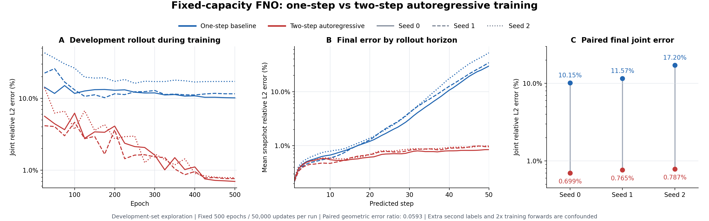

# 两步自回归对照结果

2026-10-28，BSCC-N26，固定协议 first/rollout2 × seed0/1/2

相同模型、相同更新数下，两步自回归在三个种子上都大幅降低了长程滚动误差，配对误差比的几何平均为 **0.0592854**，对应降低 **94.07%**，通过预设的 0.90 实用门槛

这里的改善是开发集上的训练方案对照结果，三种子并未进行统计显著性检验

## 固定最终端点

| 种子 | 一阶联合相对 L2 | 两步自回归联合相对 L2 | 两步 / 一阶 | 一阶第50步误差 | 两步第50步误差 |
|---|---:|---:|---:|---:|---:|
| 0 | 10.1514% | 0.6988% | 0.06884 | 29.7306% | 0.8480% |
| 1 | 11.5707% | 0.7652% | 0.06613 | 34.3468% | 0.9541% |
| 2 | 17.1977% | 0.7872% | 0.04577 | 52.2298% | 0.9898% |

主要指标先对每条开发轨迹合并51个等权快照求物理空间相对 L2，再对20条轨迹取均值，51个快照包含所给初态的归一化往返，范数使用 float64 归约

全部六次训练均完成500轮、50,000次更新，最终学习率为零；总计30万次更新与3000条轮日志，同一种子两臂的初始化、输入哈希及500轮 shuffle 完全配对

曲线每25轮评测一次，采用固定第500轮模型，未按开发指标选择检查点或替换种子

## 训练方式与成本

两臂均使用 width20、modes12×12、四层 GELU OSG-FNO，共928,461个实参数分量，同一80条训练轨迹和20条开发轨迹、2,000个固定窗口

记第一步预测为 `p1=G(z0,h1)`，两步递推为 `p2=G(p1,h2)`，`d` 为以真值范数为分母的相对 L2 损失

一阶基线优化 `d(z1,p1)`，两步自回归优化 `[d(z1,p1)+d(z2,p2)]/2`，第二项的梯度完整经过第一步预测，模型在训练时直接接触自己产生的中间状态

本轮没有 GDSG、生成元或额外正则，第二项直接监督两步后的真实状态

| 成本 | 一阶三种子合计 | 两步三种子合计 | 比值 |
|---|---:|---:|---:|
| 训练计时 | 3705.30秒 | 5237.20秒 | 1.4134 |
| 优化更新 | 150,000 | 150,000 | 1.0000 |
| 训练 forward | 150,000 | 300,000 | 2.0000 |
| 单次峰值分配显存 | 301,221,888字节 | 501,076,480字节 | 1.6635 |

训练计时覆盖优化过程，排队与分配开销另计；真实 Slurm 的六次训练合计占用单卡9269秒，回放聚合另用单卡34秒，未取得本轮实际货币账单

## 对参数量、收敛与空间结构的判断

模型参数量和空间结构完全相同，改训练目标就让最终滚动误差从10–17%降到0.7–0.8%，因此当前一阶基线的长程误差差距主要指向多步训练目标与滚动稳定性，单纯参数过少不足以解释这组差距

一阶基线最后50轮的联合误差仅分别改善约1.93%、1.40%，种子2反而上升0.23%；两步方案同期改善约3.26%、3.28%、1.70%，曲线已较平缓，现有证据不支持仅靠继续延长同一阶训练就消除这组差距

第1步误差基本接近，两步方案在种子0/1上还略高；优势随滚动步数增加而扩大，到第50步明显分离，这与改善长程误差积累的解释一致

本轮空间感受野、频率截断与模型容量保持固定，未直接测量扩宽或提高 Fourier 模态数的收益；更大模型仍可作为后续独立变量

## 结论边界与下一项判别实验

20条开发轨迹已在此前探索中使用，本轮结果用于筛选训练方案，后续泛化结论需要新冻结的独立轨迹

两步方案同时增加第二标签覆盖和训练 forward，本轮识别的是整套训练方案的效果，额外监督与递推状态输入的贡献尚未分开

下一项优先对照是 teacher2：使用同样两个真值转移，优化 `[d(z1,G(z0,h1))+d(z2,G(z1,h2))]/2`，与 rollout2 配对初始化、批次、两次 forward 和更新数，主要区别是第二步输入使用真值还是模型预测

再用匹配训练计算预算的一阶基线检查额外计算的贡献，并在独立新轨迹上确认；这些是待确定的新方案，本轮没有新增或重训

## 完成与回收证据

正式数组2420813的六项及回收作业2420820均经真实 `sacct` 核实为 COMPLETED 0:0，相关 `squeue` 为空

分配的 V100 上独立加载六个最终检查点，所有模型与优化器张量有限，六次物理空间指标复算与训练回执完全相同，最大差值均为零，回放聚合优化更新为零

紧凑远端归档为3,424,628字节、231个成员，SHA-256为 `e72d8b8ef9f80266c2f687f6e881b207f693ca032abe45f81f45f15ac47497dc`，已核对独立远端回执、精确内部清单及逐文件大小与哈希

本地与 GitHub 保留代码、配置、标量曲线、指标、回执与必要日志，模型权重、优化器状态、原始预测和数据缓存均未下载或上传

原始聚合、运行回执、曲线、调度终态和独立复核见 [紧凑结果目录](results/README.zh.md)
